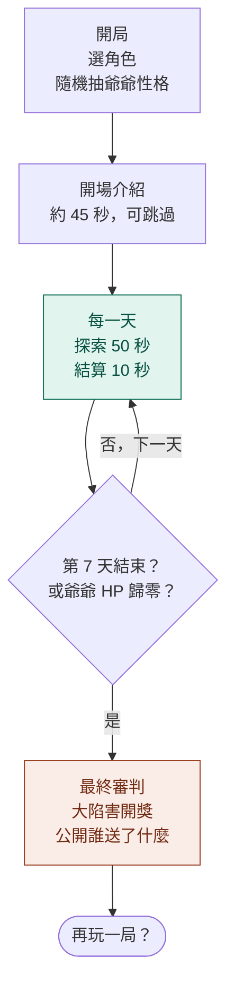
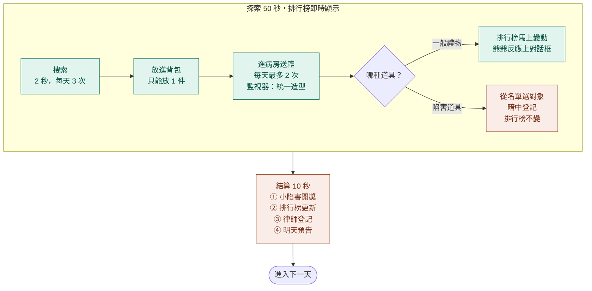
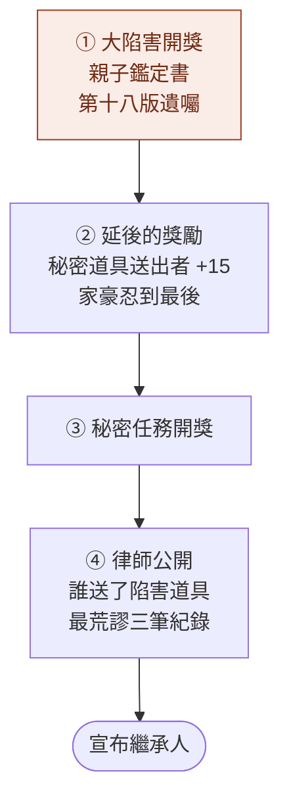

# 遊戲流程圖

本頁為 2026-11-20 新增，依目前的 <a href="./mechanics/">遊戲機制規格</a> 繪製。規格改動時請一起更新本頁。

流程圖用 [Mermaid](https://mermaid.js.org/) 語法寫在本頁的原始檔裡，直接改文字就能改圖。每行文字盡量保持在 10 個字以內，太長會被切掉。

## 一局遊戲

## 一天的流程

探索期間可以重複「搜索 → 送禮」，背包空了就再去找。

綠色：馬上生效。橘紅色：暗中登記、之後才開獎。

- 結算的「小陷害開獎」也包含角色秘密道具
- 大陷害留到最終審判才開獎
- 角色能力在探索期間隨時可以用；第 2 到 6 天可能抽到隨機事件。為了讓圖清楚，沒有畫進去

## 最終審判的順序

相關規則：[送禮](./mechanics/#送禮)、[即時排行榜](./mechanics/#即時排行榜)、[陷害道具](./content/items/traps)、[最終審判](./mechanics/#最終審判)。
