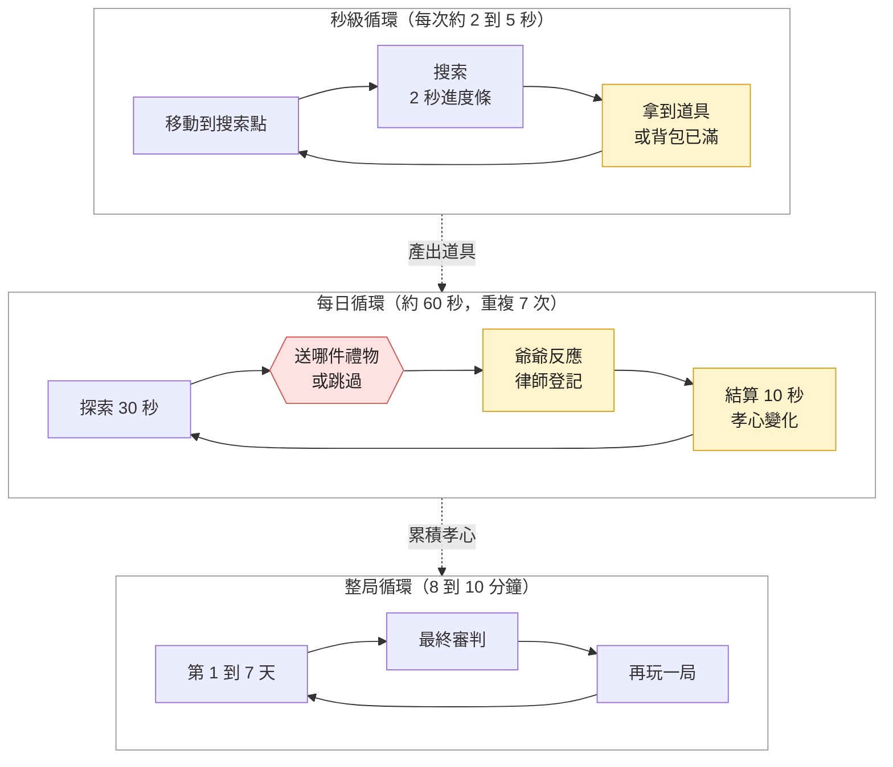

# 核心循環 <Badge type="danger" text="2 / 5 未達門檻" />

::: info 這個框架在看什麼
核心循環是玩家在遊戲裡反覆做的事。把它畫成「動作 → 回饋 → 獎勵 → 下一個動作」的圈，就能看出哪裡單調、哪裡缺回饋。通常分三層：**秒級**（每幾秒重複的動作）、**每日**（一回合的完整流程）、**整局**（一整局的結構與重玩動機）。

**用來解決**：遊戲玩起來重複卻說不出原因、不知道玩家每分鐘在做什麼決定、前後期體驗沒有差別。
:::

::: details 檢核標準
- 每一圈是否至少有一個「有意義的選擇」？有意義的選擇要有取捨、沒有明顯最佳解、後果看得到。
- 每一圈是否有清楚的回饋與獎勵？
- 循環會不會隨時間變化或升級？
- 同時需要顧的事是否過多？
:::

## 現況

### 三層循環

紅色是玩家唯一的有意義選擇，黃色是回饋與獎勵。

### 每一層的體檢

| 循環 | 有意義的選擇 | 回饋與獎勵 | 會不會變化 |
| --- | --- | --- | --- |
| 秒級 | ❌ 沒有：搜到什麼就是什麼 | ⚠️ 只有拿到道具 | ❌ 不會 |
| 每日 | ⚠️ 只有一個：送哪件，或跳過 | ✅ 爺爺反應很強 | ❌ 第 1 到 6 天相同，只有 60% 機率的事件 |
| 整局 | ⚠️ 秘密任務帶來一點長線目標 | ⚠️ 只有孝心數字 | ❌ 每局結構相同 |

::: tip 做得好的地方
- 送禮反應是很強的回饋，每次送禮都有笑點。
- 一局 8 到 10 分鐘，循環長度適合派對遊戲。
:::

## 問題點

1. **每天只有一個選擇**：送哪件禮物，或乾脆跳過。
2. **背包只有一格**：搜到什麼就送什麼，那唯一的選擇也被壓縮了。
3. **七天流程完全一樣**：第三天之後開始重複，事件只有 60% 機率出現。
4. **獎勵單一**：回饋很強，但獎勵只有孝心數字。

## 改善方向

| 做法 | 解決的問題 | 成本 |
| --- | --- | --- |
| **每天不同的爺爺心願**：早上說一句謎語般的心願，送出符合的道具有加成，逐天變難 | 3 | 低 |
| **加深送禮的取捨**：署名栽贓、搶功勞、挑時機送 | 1、2 | 低到中 |
| **讓 HP 成為全員在意的資源**：炸雞這類「加孝心扣 HP」的道具變成真正的兩難 | 1、4 | 低 |

預期分數 2 → 3。詳見 [首次檢核報告](../reviews/2026-11-17)。
