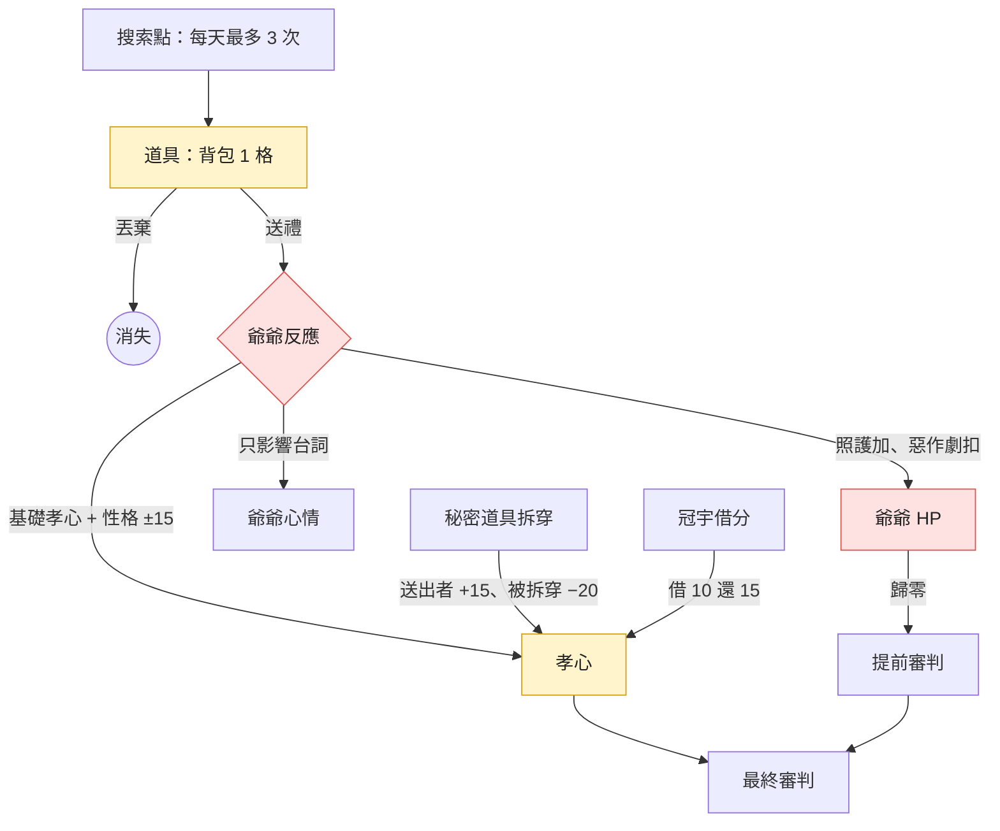

# 經濟與平衡（Machinations 思維） <Badge type="warning" text="3 / 5 剛好達標" />

::: info 這個框架在看什麼
Machinations 是 Joris Dormans 提出的方法，用節點和流向表示遊戲裡的資源怎麼**產生、流動和消耗**，也有同名的線上工具可以跑模擬。這裡先用圖整理，等規則穩定後再用工具調數值。

**用來解決**：有一招打遍天下的必勝法、領先者越滾越大落後者提早放棄、角色或道具之間明顯不平衡。
:::

::: details 檢核標準
- 是否存在必勝法或明顯的最佳策略？
- 領先者是否會越滾越大？
- 落後者是否有翻盤機會？
- 角色或能力之間是否明顯不平衡？
:::

## 現況

### 資源流向圖

道具從搜索點流出，經過送禮變成孝心，同時增減爺爺的 HP。黃色是主要資源，紅色是目前的平衡問題所在：爺爺反應有固定最佳解，HP 只有少數人在意。

### 資源清單

| 資源 | 來源 | 消耗或流向 |
| --- | --- | --- |
| 孝心 | 送禮、秘密任務、拆穿別人的秘密道具、借分 | 送錯禮扣分、被拆穿扣分、還借款 |
| 爺爺 HP | 照護類禮物 | 惡作劇與部分禮物扣 HP；歸零提前審判 |
| 爺爺心情 | 禮物 | 影響台詞 |
| 道具 | 搜索點抽獎，每點每天 3 次 | 送禮、丟棄 |
| 能力次數 | 每天或每局固定次數 | 使用後減少 |

### 誰在意爺爺的 HP

| 角色 | 希望爺爺 | 原因 |
| --- | --- | --- |
| 安然 | 早點死 | 秘密任務：第 7 天前 HP 歸零 +30 |
| 冠宇 | 早點死（有借款時） | 遊戲提早結束，借款不用還 |
| 被冠宇借分的人 | 晚點死 | 等著拿回 15 孝心 |
| 其他人 | 無所謂 | ❌ HP 跟勝負沒有關係 |

::: tip 做得好的地方
- 安然希望爺爺早死、其他人希望他晚點死，已經有利益衝突的雛形。
- 冠宇的借分在遊戲提早結束時不用還，會讓他和被借的人在意 HP。
- 炸雞這類「加孝心但扣 HP」的道具，已經有兩難的潛力。
:::

## 問題點

1. **猜到喜好後有固定最佳解**：性格修正 ±15 很大，猜出喜好後，最佳策略就是只送喜愛分類的道具。
2. **愛面子局的道具集中**：只有 5 件奢侈道具能拿高分，搜到的人會大幅領先。
3. **HP 只對少數人有意義**：大多數人沒有保護爺爺的動機，HP 系統的張力浪費了。
4. **翻盤機會少**：除了秘密道具拆穿（−20／+15），落後者缺乏追趕手段。

## 改善方向

| 做法 | 解決的問題 | 成本 |
| --- | --- | --- |
| **HP 歸零全員失敗**：遺產充公，所有人都得顧 HP，炸雞變成真正的兩難 | 3 | 低 |
| **每天不同的爺爺心願**：心願加成打破「只送喜愛分類」的固定解 | 1、2 | 低 |
| **簽約後的最後一夜**：落後者有一段專屬的翻盤時間 | 4 | 中 |

預期分數 3 → 4。數值待規則穩定後用遊測資料調整，詳見 [首次檢核報告](../reviews/2026-11-17)。
