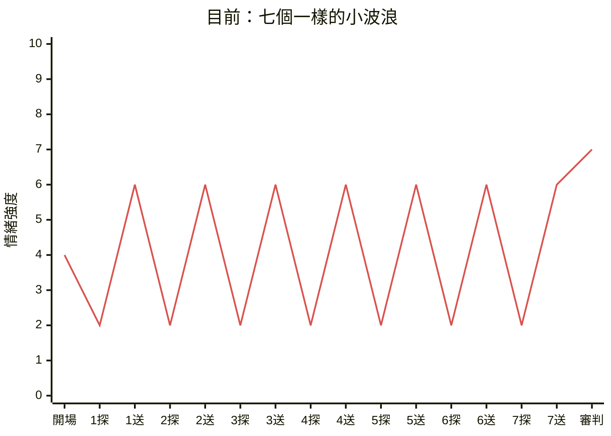
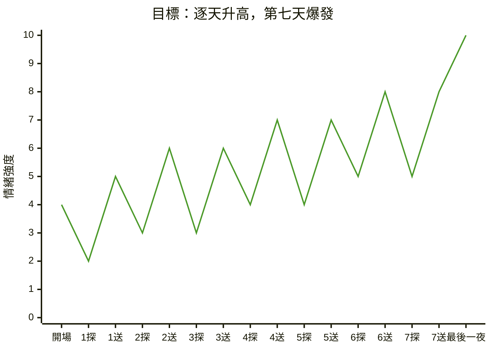

# 情緒曲線 <Badge type="danger" text="2 / 5 未達門檻" />

::: info 這個框架在看什麼
把一局遊戲依時間切段，標出每段玩家預期的情緒，例如期待、緊張、爆笑、背叛、放鬆。用來檢查節奏是否有起伏，以及是否有明確的高潮。

**用來解決**：遊戲中段無聊、玩家分心；高潮不夠強、結尾無力；刺激太密集、玩家疲乏。
:::

::: details 檢核標準
- 有沒有長時間的平線（無聊時段）？
- 高峰是否太密集造成疲乏？
- 是否有逐漸升高的節奏和一個明確的高潮？
- 結尾是否有收束感，讓人想再玩一局？
:::

## 現況

### 目前的預估曲線

橫軸的「1探」是第 1 天探索、「1送」是第 1 天送禮，以此類推。每天的形狀幾乎一樣：探索時情緒低，病房送禮時出現笑點，結算後回落。七天是七個一樣高的小波浪，最終審判只比平常高一點。

### 各時段體檢

| 時段 | 情緒 | 評估 |
| --- | --- | --- |
| 開場 | 期待：抽性格、看角色 | ✅ |
| 每天探索 30 秒 | 低：各自在私人房間搜索 | ⚠️ 每天都是低谷 |
| 每天病房送禮 | 爆笑：爺爺反應、律師登記 | ✅ 有笑點，但強度不會升高 |
| 第 2 到 6 天事件 | 隨機出現，60% 機率 | ⚠️ 不一定落在需要的時間點 |
| 最終審判 | 公布分數 | ❌ 缺乏翻轉，高潮不夠強 |

::: tip 做得好的地方
每天都有固定的笑點（送禮反應），不會整天完全沒有起伏。
:::

## 問題點

1. **沒有逐漸升高**：第二到第六天是重複的小波浪。
2. **笑點強度不變**：每天差不多，玩家很快就習慣了。
3. **高潮不夠強**：最終審判只是公布分數，缺乏翻轉或衝突。
4. **假死事件位置隨機**：不一定出現在需要高潮的時間點。
5. **七天章節只是旁白**：[開場與固定事件](../content/events/fixed) 已經寫好每天不同的爺爺狀態與劇情揭露，但沒有接到玩法，玩家的操作每天都一樣。

## 改善方向

### 目標曲線

低谷逐天墊高、高峰逐天變強，第七天用「最後一夜」拉出全局最高點。

| 做法 | 解決的問題 | 成本 |
| --- | --- | --- |
| **簽約後的最後一夜**：第七天加 60 秒，爺爺每 20 秒改一次遺囑；領先者希望他安詳離開，落後者拚命保護他衝分翻盤 | 3 | 中 |
| **把七天章節變成每日心願**：照章節裡爺爺當天的狀態給加成，例如第 1 天想喝雞湯、第 4 天生日要送貴的 | 1、2、5 | 低 |
| **爺爺點名**：探索時段突然點名，讓低谷也有小高峰 | 1 | 低 |
| **固定假死事件的時間點**：例如固定在第四或第五天，當作中段高潮 | 4 | 低 |

預期分數 2 → 4。詳見 [檢核報告](../reviews/2026-11-17)。
