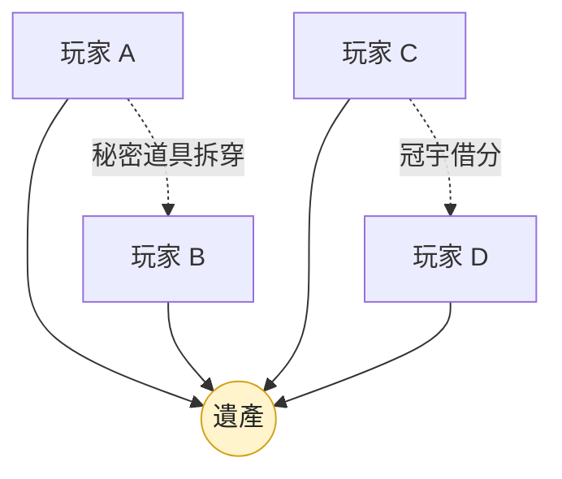

# 形式元素 <Badge type="warning" text="3 / 5 剛好達標" />

::: info 這個框架在看什麼
出自 Tracy Fullerton 的《Game Design Workshop》，把任何遊戲拆成八個元素：**玩家、目標、流程、規則、資源、衝突、邊界、結果**。逐項填寫，就能檢查規則是否完整、元素之間是否互相支撐。

**用來解決**：規格書寫了很多卻漏掉關鍵部分、說不出衝突從哪裡來、規則越修越多互相打架。
:::

::: details 檢核標準
- 八個元素是否都明確？
- 衝突從哪裡來、是否夠強？衝突弱通常代表無聊。
- 核心規則能否在一分鐘內講完？
- 有沒有規則只是為了修補另一條規則而存在？
:::

## 現況

### 八個元素體檢

| 元素 | 狀態 | 目前內容 |
| --- | :---: | --- |
| 玩家 | ✅ | 4 人，從角色池各選一個角色 |
| 目標 | ✅ | 七天後孝心最高，繼承遺產 |
| 流程 | ✅ | 每天：探索 → 病房 → 結算，共七天 |
| 規則 | ⚠️ | 搜索、背包一格、送禮、性格喜惡、角色能力；部分待決 |
| 資源 | ✅ | 孝心、爺爺 HP 與心情、道具、能力次數 |
| 衝突 | ❌ | 搶同一個遺產；秘密道具拆穿；冠宇借分 |
| 邊界 | ✅ | 豪宅五個房間、七天、每天固定時間 |
| 結果 | ⚠️ | 孝心最高者獲勝；HP 歸零提前審判，但勝負意義不清 |

✅ 明確　⚠️ 有缺口　❌ 薄弱

### 衝突從哪裡來

四個人都朝同一份遺產衝分，但彼此之間只有少數虛線能直接出手，比較像四個人平行玩單人遊戲。

::: tip 做得好的地方
核心規則（找東西送爺爺、猜他的喜好、孝心最高的人贏）可以在一分鐘內講完。
:::

## 問題點

1. **衝突太弱**：主要是「各自衝分、比誰高」，玩家直接對抗的手段很少。
2. **HP 歸零的勝負意義不清**：只有安然的秘密任務希望爺爺早死，其他人沒有理由在意 HP。

## 改善方向

| 做法 | 解決的問題 | 成本 |
| --- | --- | --- |
| **署名栽贓、搶功勞**：所有人都能用的玩家對玩家動作 | 1 | 低到中 |
| **HP 歸零全員失敗**：第七天前 HP 歸零，遺產充公；安然的任務改成「HP 降到 10 以下但沒歸零」 | 2 | 低 |

詳見 [檢核報告](../reviews/2026-11-17)。
