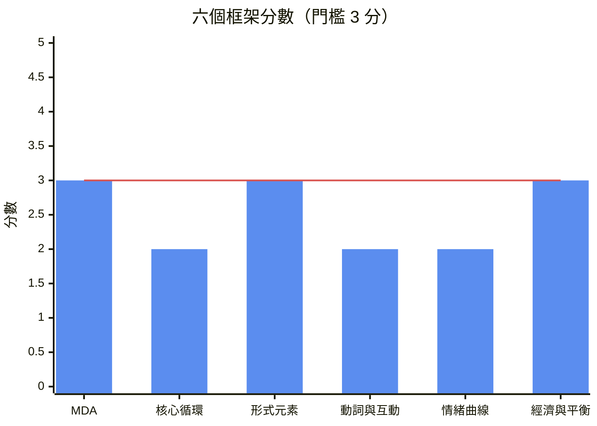

# 設計框架與評分

這裡收錄六個業界常用的遊戲設計框架。每一頁開頭是框架簡介和檢核標準，接著是三個重點：**現況**（用圖表呈現）、**問題點**、**改善方向**。

## 目前分數（2026-11-17）

藍色長條是各框架分數，紅線是 3 分的通過門檻。低於紅線的三項是目前要優先處理的地方。

| 框架 | 目標 | 解決的問題 | 分數 |
| --- | --- | --- | --- |
| [MDA](./mda) | 對齊目標體驗 | 每條規則有沒有服務目標體驗 | 3 / 5 |
| [核心循環](./core-loop) | 整理遊戲流程 | 玩家反覆做的事是否有選擇、有變化 | 2 / 5 |
| [形式元素](./formal-elements) | 完整的規則文件 | 規則是否完整，衝突從哪裡來 | 3 / 5 |
| [動詞與互動矩陣](./verbs-interactions) | 整理玩家間互動 | 玩家能做什麼、跟誰互動 | 2 / 5 |
| [情緒曲線](./emotion-curve) | 規劃一局的節奏與高潮 | 中段會不會無聊、結尾夠不夠強 | 2 / 5 |
| [經濟與平衡](./economy) | 確認數值平衡 | 資源流動、必勝法、翻盤機會 | 3 / 5 |

**整體判斷：太單薄。** 笑點內容很強，但玩家之間的互動少、每天流程重複、缺乏高潮。完整分析見 [首次檢核報告](../reviews/2026-11-17)。

## 評分基準

| 分數 | 意義 |
| --- | --- |
| 5 | 完整且有深度，幾乎沒有問題 |
| 4 | 大致完整，有小缺口 |
| 3 | 基本可用，但有明顯單薄或過度複雜之處 |
| 2 | 有關鍵缺口，會直接影響體驗 |
| 1 | 缺乏或嚴重失衡 |

階段 1 的通過門檻是六個框架都達到 3 分以上。

## 派對遊戲的複雜度參考基準

- 規則解釋時間在 3 分鐘內
- 核心動詞 3 到 6 個
- 玩家同時需要追蹤的資訊不超過 3 到 4 項
- 每一回合至少有一個有意義的選擇

## 怎麼重新評分

使用 repo 裡的 `skills/game-design-review/SKILL.md`，把最新的機制規格交給 AI 助理檢核。新的報告存到 `reviews/`，檔名用日期，並更新本頁和各框架頁的分數。
