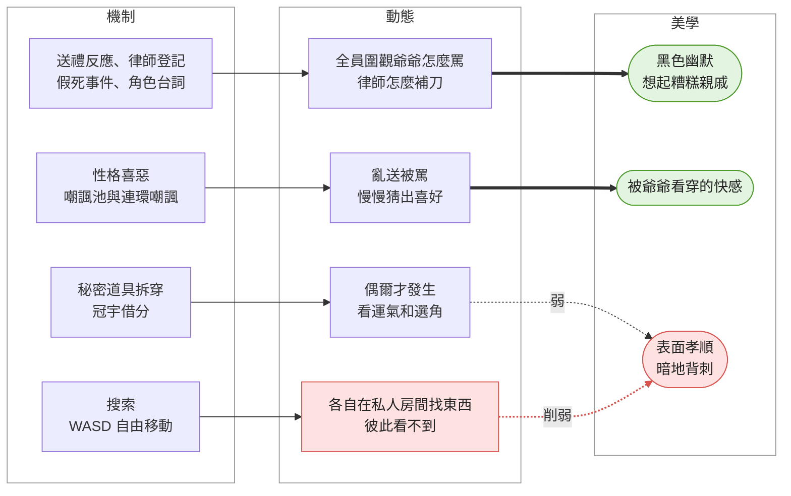

# MDA（機制 → 動態 → 美學） <Badge type="warning" text="3 / 5 剛好達標" />

::: info 這個框架在看什麼
MDA 由 Hunicke、LeBlanc 和 Zubek 提出，把遊戲分成三層：**機制**（規則、數值、玩家能做的動作）→ **動態**（規則實際玩起來會發生什麼）→ **美學**（玩家感受到的情緒）。設計者從機制往上做，玩家從美學往下感受；討論時建議從美學往回推，先決定玩家要感受到什麼，再設計規則。

**用來解決**：團隊對「好玩在哪」沒有共識、規則越加越多卻說不出目的、想要的感受沒有規則支撐。
:::

::: details 檢核標準
- 目標美學是否明確？
- 每個機制能否對應到至少一種目標美學？對應不到的可能是多餘的複雜度。
- 每種目標美學是否有機制支撐？沒有支撐的就是太單薄的地方。
- 機制實際產生的動態，是否和目標美學一致？
:::

## 現況

### 機制 → 動態 → 美學

左邊是規則，中間是規則實際玩起來會發生什麼，右邊是玩家感受到的體驗。粗線是強支撐，虛線是弱支撐，紅線是反效果。

| 機制 | 動態（實際玩起來會發生什麼） | 美學 | 支撐程度 |
| --- | --- | --- | --- |
| 送禮反應、律師登記、假死事件、角色台詞 | 每次送禮，全員圍觀爺爺怎麼罵、律師怎麼補刀 | 黑色幽默 | ✅ 強 |
| 性格喜惡、嘲諷池、連環嘲諷 | 前幾天亂送被罵，慢慢猜出爺爺的喜好 | 被看穿 | ✅ 強 |
| 秘密道具拆穿、冠宇借分 | 偶爾才發生，要看有沒有搜到道具、有沒有人選冠宇 | 暗地背刺 | ⚠️ 弱 |
| 搜索、WASD 自由移動 | 各自在私人房間找東西，彼此看不到 | 暗地背刺 | ❌ 反效果：變成平行玩單人遊戲 |

::: tip 做得好的地方
黑色幽默和「被看穿」都有多個機制支撐，是這款遊戲最穩的兩根柱子。
:::

## 問題點

1. **暗地背刺缺乏支撐**：取消揭發後只剩秘密道具和冠宇的能力，大部分玩家整局都碰不到背刺。
2. **搜索和移動的動態跟背刺相反**：私人房間彼此看不到，自由移動沒有帶來碰面、偷聽或搶奪，大家各自找東西，像平行玩單人遊戲。

## 改善方向

| 做法 | 解決的問題 | 成本 |
| --- | --- | --- |
| **署名栽贓**：送禮前把禮物卡換成別人的名字 | 1 | 低到中 |
| **搶功勞**：別人送禮時喊「我也有出錢」分走一半孝心 | 1 | 低到中 |
| **爺爺點名**：突然喊「B 棟過來！」，被點到的人 10 秒內跑回病房，全員在走廊碰面 | 2 | 低 |

預期分數 3 → 4。詳見 [檢核報告](../reviews/2026-11-17)。
